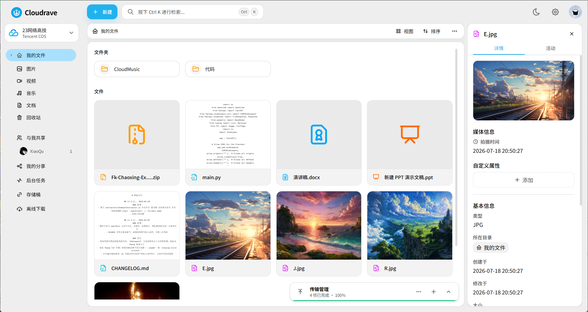

<h1 align="center">
  <br>
  <a href="https://github.com/ipycc/cloudrave" alt="logo"></a>
  <br>
  Cloudrave
  <br>
</h1>

<div align="center"></img></div>
<h4 align="center">Cloudrave — 支持多存储策略的公有云文件系统 API。</h4>

<p align="center">
  <a href="https://fastapi.tiangolo.com/"></a>
  <a href="https://www.python.org/"></a>
  <a href="https://www.sqlalchemy.org/"></a>
</p>

<p align="center">
  <a href="#-简介">简介</a> •
  <a href="#-特性">特性</a> •
  <a href="#-快速开始">快速开始</a> •
  <a href="#-配置">配置</a> •
  <a href="#-技术栈">技术栈</a> •
  <a href="#-许可证">许可证</a>
</p>

## 📖 简介

Cloudrave，基于 Python + FastAPI 构建，提供文件存储、用户认证、分享、回收站、在线预览等核心能力的 RESTful API。

后端采用异步 SQLAlchemy ORM，支持 SQLite、PostgreSQL 和 MySQL 多种数据库；存储层支持本地文件系统与腾讯云 COS，并可通过适配器模式扩展更多云存储后端。

## ✨ 特性

- 🔐 支持 JWT 访问令牌 + Refresh Token、TOTP 双因素认证与 Passkey/WebAuthn 登录
- 👤 多用户、用户组与基于角色的权限控制（RBAC）
- ☁️ 支持本地文件系统、腾讯云 COS 等多种存储策略
- 📁 文件浏览、目录管理、分片上传、断点续传、并行上传
- 🔗 文件与目录分享链接，支持密码与过期时间
- 🗑️ 回收站机制，支持恢复与自动清理
- 🖼️ 视频、音频、图片、PDF、Office、文本等在线预览（视频海报生成依赖 FFmpeg）
- 📦 压缩包在线预览、多文件打包下载
- 🧩 管理后台 API：用户管理、存储策略、挂载管理、系统设置
- 📝 结构化日志、请求追踪、速率限制与安全响应头

## 🚀 快速开始

### 环境要求

- Python >= 3.12
- 数据库：SQLite / PostgreSQL / MySQL（任选其一，默认 SQLite）
- 如需生成视频海报，请安装 FFmpeg 并确保在系统 PATH 中

### 安装依赖

```bash
cd Cloudrave
pip install -e ".[dev]"
```

### 启动服务

```bash
python main.py
```

默认监听 `0.0.0.0:1309`，API 文档可在开发环境访问：

- Swagger UI: http://127.0.0.1:1309/api/docs
- ReDoc: http://127.0.0.1:1309/api/redoc

生产环境下 `/api/docs` 会自动禁用。

## ⚙️ 配置

首次启动时会自动在项目目录下创建 `config.ini`，主要配置项如下：

```ini
[app]
name = Cloudrave
env = development
host = 0.0.0.0
port = 1309
cors_origins = http://localhost:9130,http://127.0.0.1:9130
local_upload_root = upload
preview_cache_root = data/preview-cache

[database]
database = sqlite
sqlite_path = data/cloudrave.db
mysql_host = 127.0.0.1
mysql_port = 3306
mysql_user = root
mysql_password = change-me
mysql_name = cloudrave
postgresql_host = 127.0.0.1
postgresql_port = 5432
postgresql_user = postgres
postgresql_password = change-me
postgresql_name = cloudrave
pool_size = 10
max_overflow = 20
pool_pre_ping = true

[auth]
jwt_secret = change-me-cloudrave-jwt-secret-at-least-32-bytes
access_token_ttl_minutes = 15
refresh_token_ttl_days = 30

[logging]
level = INFO
use_color = true
```

生产部署前请务必修改 `jwt_secret`、`totp_secret_key`、`backup_codes_key`、`share_signing_key` 等敏感密钥。

### 数据库切换

`[database].database` 仅接受 `sqlite`、`mysql` 或 `postgresql`。MySQL/PostgreSQL 用户需要提前创建，并授予建库、建表、索引、读写和事务权限。管理员在切换向导中测试连接时，如果目标数据库不存在，Cloudrave 会自动创建；如果用户没有建库权限，页面会给出明确提示，此时也可以由数据库管理员预先创建目标数据库。

管理员可从前端“系统设置 → 数据库”完成连接测试和数据迁移。运行中修改 `config.ini` 后，前端会自动显示迁移向导；可以选择把当前库的数据复制到目标库，或保留目标库现有数据。复制前会为非空目标库生成带 SHA-256 清单的逻辑备份。数据库元数据迁移完成后需要手动重启后端，原数据库和存储中的物理文件都不会被删除。

`CLOUDRAVE_DATABASE_URL` 或非空的 `[database].url` 仍具有最高优先级。使用这两种覆盖方式时，管理页面只显示连接来源，不允许通过分字段向导切换数据库。

### GitHub OAuth 登录

管理员可在“设置 → 账号与安全”中配置 GitHub OAuth App 的 Client ID 与 Client Secret。配置前先在“站点设置”保存站点的 HTTPS 网站链接，再将页面生成的 `Authorization callback URL` 原样填写到 GitHub OAuth App。

GitHub 登录只用于已有 Cloudrave 账号：首次登录会使用 GitHub 返回的已验证邮箱匹配本地账号并建立身份关联，不会自动创建新用户。Client Secret 加密保存在数据库中，管理接口只返回是否已配置。

## 📦 构建与部署

### 全栈模式（前后端同一端口）

Cloudrave 后端可以嵌入前端编译产物，作为统一服务运行：

1. 构建前端并嵌入到后端 `assets/` 目录：

```bash
pnpm install --frozen-lockfile
pnpm build
```
- 将 `./frontend/dist/` 复制到 `./Cloudrave/assets/`

2. 启动后端：

```bash
cd Cloudrave
python main.py
```

访问 `http://localhost:1309/` 即可同时访问前端与 API。

如果 `Cloudrave/assets/` 为空（只有 `.gitkeep`），后端将仅作为 API 服务运行。

### 构建独立可执行文件

#### 本地打包（当前平台）

```bash
cd Cloudrave
pip install -e ".[build]"
python build_binary.py
```

输出为单文件可执行程序：

- Windows：`dist/cloudrave.exe`
- Linux / macOS：`dist/cloudrave`

首次运行后，可执行文件同级目录会自动生成 `config.ini`、数据库与上传目录，这些文件会持久化保留。

#### 一步完成前端嵌入 + 二进制打包

```bash
python build-fullstack.py --binary
```

#### 多平台 CI 打包

仓库包含 [`.github/workflows/build-binaries.yml`](.github/workflows/build-binaries.yml)。手动触发会进行一次不发布的多平台构建预演；推送 `v*` 标签后，会构建完整嵌入前端的 Linux x86_64、Windows x86_64、macOS ARM64 与 macOS Intel 原生可执行文件，并连同 SHA-256 校验清单直接发布到 GitHub Release（不再套用 ZIP 或 tar.gz 压缩包）。

发布使用的前端提交固定记录在 [`.frontend-ref`](.frontend-ref) 中。更新前端后，应先通过前端验证并推送提交，再更新此文件，确保发布构建可复现。

```bash
git tag -a v1.0.0-beta.1 -m "Cloudrave v1.0.0-beta.1"
git push origin v1.0.0-beta.1
```

## 🛠️ 技术栈

- [Python 3.12+](https://www.python.org/) + [FastAPI](https://fastapi.tiangolo.com/) + [Uvicorn](https://www.uvicorn.org/)
- [SQLAlchemy 2.0](https://www.sqlalchemy.org/) + [Alembic](https://alembic.sqlalchemy.org/) 异步数据库访问与迁移
- [Pydantic](https://docs.pydantic.dev/) 数据校验与配置管理
- [Argon2](https://argon2-cffi.readthedocs.io/) 密码哈希 + [PyJWT](https://pyjwt.readthedocs.io/) 令牌
- [PyOTP](https://pyotp.readthedocs.io/) TOTP 双因素认证 + [webauthn](https://github.com/duo-labs/py_webauthn) Passkey
- 前端：[React 19](https://react.dev/) + [Vite](https://vitejs.dev/) + [Tailwind CSS](https://tailwindcss.com/)

## 📜 许可证

MIT
