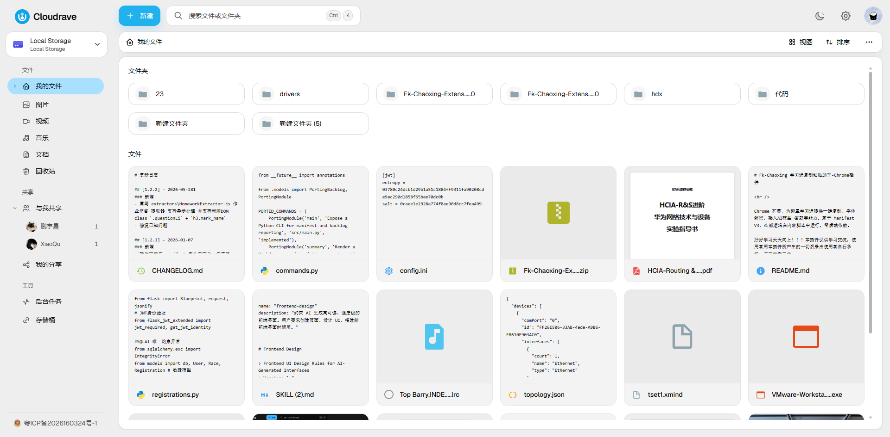

<h1 align="center">
  <br>
  <a href="https://github.com/ipycc/cloudrave" alt="logo"></a>
  <br>
  Cloudrave
  <br>
</h1>

<div align="center"></img></div>
<h4 align="center">Cloudrave — 支持多存储策略的公有云文件系统 API。</h4>

<p align="center">
  <a href="https://fastapi.tiangolo.com/"></a>
  <a href="https://www.python.org/"></a>
  <a href="https://www.sqlalchemy.org/"></a>
  <a href="https://github.com/iPycc/Cloudrave/releases/tag/v1.0.0-beta.4"></a>
</p>

<p align="center">
  <a href="#-简介">简介</a> •
  <a href="#-特性">特性</a> •
  <a href="#-快速开始">快速开始</a> •
  <a href="#-配置">配置</a> •
  <a href="#-技术栈">技术栈</a> •
  <a href="#-许可证">许可证</a>
</p>

## 📖 简介

Cloudrave 是基于 Python + FastAPI 的多用户文件管理服务，提供身份认证、文件管理、分享、回收站和在线预览 API。当前开发版本为 **v1.0.0-beta.5**。

后端采用异步 SQLAlchemy ORM，支持 SQLite、PostgreSQL 和 MySQL。存储策略可连接本地文件系统、腾讯云 COS、阿里云 OSS，以及 139 移动云盘、189 天翼云盘和联通云盘。

## ✨ 特性

- **存储后端**：本地文件系统、腾讯云 COS、阿里云 OSS；139 移动云盘、189 天翼云盘、联通云盘以用户凭据连接。
- **文件管理**：目录浏览、创建、重命名、移动、复制、回收站恢复和永久删除；支持多挂载及容量信息。
- **上传和下载**：分片并行上传、断点续传、重复文件检查及下载；对象存储使用直传能力，运营商网盘优先直传，浏览器跨域或网络错误时可经 Cloudrave 中转上传分片。
- **预览与编辑**：图片、视频、音频、PDF、Office、文本和压缩包预览；文本与 Markdown 保存、PDF 注释及图片另存为。
- **分享**：文件和目录分享链接、访问密码、过期时间和分享下载。
- **账号与权限**：JWT 与 Refresh Token、TOTP 双因素认证、Passkey/WebAuthn、GitHub/Google/QQ OAuth 关联；用户、管理员和访客权限控制。
- **管理与运维**：存储策略和挂载管理、数据库连接测试与迁移、站点设置、审计记录、结构化日志、请求追踪、速率限制与安全响应头。

### 存储能力说明

| 驱动 | 浏览与下载 | 上传 | 说明 |
| --- | --- | --- | --- |
| 本地文件系统 | 支持 | 后端接收 | 支持目录与文件管理 |
| 腾讯云 COS | 支持 | 浏览器直传、分片上传 | 可配置桶 CORS |
| 阿里云 OSS | 支持 | 浏览器直传、分片上传 | CORS 由 OSS 配置管理 |
| 139 移动云盘 | 支持 | 浏览器直传；失败时可由后端中转分片 | 通过登录凭据连接 |
| 189 天翼云盘 | 支持 | 浏览器直传；失败时可由后端中转分片 | 上传分片按运营商要求计算 MD5 |
| 联通云盘 | 支持 | 浏览器直传或运营商上传协议 | 通过 WoCloud Web Token 连接 |

运营商网盘的凭据由管理员或挂载所有者维护。中转上传会让文件分片经过 Cloudrave 服务器，部署时应为临时文件和请求体配置足够的磁盘空间与带宽。驱动能力受运营商接口和账号权限限制。

## 🚀 快速开始

### 环境要求

- Python >= 3.12
- 数据库：SQLite / PostgreSQL / MySQL（任选其一，默认 SQLite）
- 如需生成视频海报，请安装 FFmpeg 并确保在系统 PATH 中

### 安装依赖

```bash
cd Cloudrave
pip install -e ".[dev]"
```

### 启动服务

```bash
python main.py
```

默认监听 `0.0.0.0:1309`，API 文档可在开发环境访问：

- Swagger UI: http://127.0.0.1:1309/api/docs
- ReDoc: http://127.0.0.1:1309/api/redoc

生产环境下 `/api/docs` 会自动禁用。

## ⚙️ 配置

首次启动时会自动在项目目录下创建 `config.ini`，主要配置项如下：

```ini
[app]
name = Cloudrave
env = development
host = 0.0.0.0
port = 1309
cors_origins = http://localhost:9130,http://127.0.0.1:9130
local_upload_root = upload
preview_cache_root = data/preview-cache

[database]
database = sqlite
sqlite_path = data/cloudrave.db
mysql_host = 127.0.0.1
mysql_port = 3306
mysql_user = root
mysql_password = change-me
mysql_name = cloudrave
postgresql_host = 127.0.0.1
postgresql_port = 5432
postgresql_user = postgres
postgresql_password = change-me
postgresql_name = cloudrave
pool_size = 10
max_overflow = 20
pool_pre_ping = true

[auth]
jwt_secret = change-me-cloudrave-jwt-secret-at-least-32-bytes
access_token_ttl_minutes = 15
refresh_token_ttl_days = 30

[logging]
level = INFO
use_color = true
```

生产部署前请务必修改 `jwt_secret`、`totp_secret_key`、`backup_codes_key`、`share_signing_key` 等敏感密钥。

### 数据库切换

`[database].database` 仅接受 `sqlite`、`mysql` 或 `postgresql`。MySQL/PostgreSQL 用户需要提前创建，并授予建库、建表、索引、读写和事务权限。管理员在切换向导中测试连接时，如果目标数据库不存在，Cloudrave 会自动创建；如果用户没有建库权限，页面会给出明确提示，此时也可以由数据库管理员预先创建目标数据库。

管理员可从前端“系统设置 → 数据库”完成连接测试和数据迁移。运行中修改 `config.ini` 后，前端会自动显示迁移向导；可以选择把当前库的数据复制到目标库，或保留目标库现有数据。复制前会为非空目标库生成带 SHA-256 清单的逻辑备份。数据库元数据迁移完成后需要手动重启后端，原数据库和存储中的物理文件都不会被删除。

`CLOUDRAVE_DATABASE_URL` 或非空的 `[database].url` 仍具有最高优先级。使用这两种覆盖方式时，管理页面只显示连接来源，不允许通过分字段向导切换数据库。

### OAuth 登录

管理员先在「设置 → 站点设置」保存用户实际访问的 HTTPS 网站链接，然后到「设置 → 账号与安全」展开对应的 OAuth 配置，复制显示的回调地址。站点域名变更后，也要更新第三方平台登记的回调地址。应用密钥加密保存在数据库中，配置页只显示是否已配置。

#### GitHub

1. 在 [GitHub OAuth Apps](https://github.com/settings/developers) 选择 **New OAuth App**，将 **Homepage URL** 填为 Cloudrave 网站链接。
2. 将 Cloudrave 显示的完整回调地址填入 **Authorization callback URL**，注册应用并生成 Client Secret。
3. 回到 Cloudrave，填入 **Client ID** 和 **Client Secret**，保存并开启。

#### Google

1. 在 [Google Auth Platform](https://console.cloud.google.com/auth/overview) 选择项目，配置应用的同意屏幕和受众。如果测试状态限制了授权账号，在 **Audience** 中添加测试用户。
2. 到 **Clients** 创建 **Web application**，将 Cloudrave 显示的完整回调地址填入 **Authorized redirect URIs**。
3. 回到 Cloudrave，填入 **Client ID** 和 **Client Secret**，点击「保存配置」，再点击「测试登录」。测试通过后点击「开启 Google OAuth」。更换凭据或回调地址后需重新测试。

#### QQ

1. 在 [QQ 互联管理中心](https://connect.qq.com/manage.html#/) 创建**网站应用**，按页面要求填写站点资料和 Cloudrave 显示的回调地址，提交审核。
2. 审核通过后，在 Cloudrave 的 QQ OAuth 配置中填入 **App ID** 和 **App Key**，保存并开启。

启用后，用已有 Cloudrave 账号登录，在「账号与安全」点击对应的「关联 GitHub」「关联 Google」或「关联 QQ」。关联完成后，就能在登录页使用对应的第三方账号。

## 📦 构建与部署

### 全栈模式（前后端同一端口）

Cloudrave 后端可以嵌入前端编译产物，作为统一服务运行：

1. 构建前端并嵌入到后端 `assets/` 目录：

```bash
pnpm install --frozen-lockfile
pnpm build
```
- 将 `./frontend/dist/` 复制到 `./Cloudrave/assets/`

2. 启动后端：

```bash
cd Cloudrave
python main.py
```

访问 `http://localhost:1309/` 即可同时访问前端与 API。

如果 `Cloudrave/assets/` 为空（只有 `.gitkeep`），后端将仅作为 API 服务运行。

### 构建独立可执行文件

#### 本地打包（当前平台）

```bash
cd Cloudrave
pip install -e ".[build]"
python build_binary.py
```

输出为单文件可执行程序：

- Windows：`dist/cloudrave.exe`
- Linux / macOS：`dist/cloudrave`

首次运行后，可执行文件同级目录会自动生成 `config.ini`、数据库与上传目录，这些文件会持久化保留。

#### 一步完成前端嵌入 + 二进制打包

```bash
python build-fullstack.py --binary
```

#### 多平台 CI 打包

仓库包含 [`.github/workflows/build-binaries.yml`](.github/workflows/build-binaries.yml)。手动触发会进行一次不发布的多平台构建预演；推送 `v*` 标签后，会构建完整嵌入前端的 Linux x86_64、Windows x86_64、macOS ARM64 与 macOS Intel 原生可执行文件，并连同 SHA-256 校验清单直接发布到 GitHub Release（不再套用 ZIP 或 tar.gz 压缩包）。

发布使用的前端提交固定记录在 [`.frontend-ref`](.frontend-ref) 中。更新前端后，应先通过前端验证并推送提交，再更新此文件，确保发布构建可复现。

```bash
git tag -a v1.0.0-beta.1 -m "Cloudrave v1.0.0-beta.1"
git push origin v1.0.0-beta.1
```

## 🛠️ 技术栈

- [Python 3.12+](https://www.python.org/) + [FastAPI](https://fastapi.tiangolo.com/) + [Uvicorn](https://www.uvicorn.org/)
- [SQLAlchemy 2.0](https://www.sqlalchemy.org/) + [Alembic](https://alembic.sqlalchemy.org/) 异步数据库访问与迁移
- [Pydantic](https://docs.pydantic.dev/) 数据校验与配置管理
- [Argon2](https://argon2-cffi.readthedocs.io/) 密码哈希 + [PyJWT](https://pyjwt.readthedocs.io/) 令牌
- [PyOTP](https://pyotp.readthedocs.io/) TOTP 双因素认证 + [webauthn](https://github.com/duo-labs/py_webauthn) Passkey
- 前端：[React 19](https://react.dev/) + [Vite](https://vitejs.dev/) + [Tailwind CSS](https://tailwindcss.com/)

## 📜 许可证

MIT
